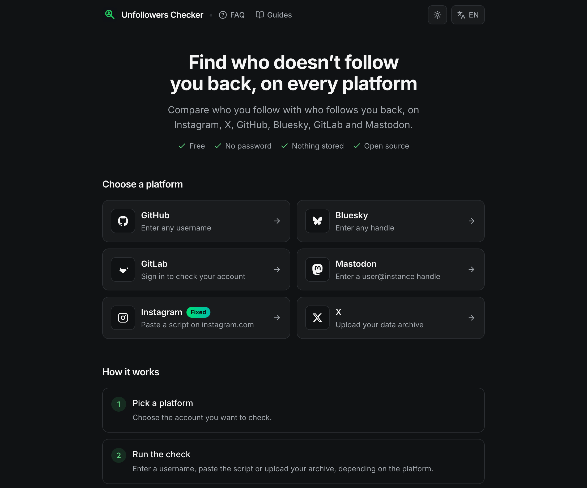

# Unfollowers Checker

See who you follow that doesn't follow you back — across **GitHub**, **Bluesky**, **GitLab**, **Mastodon**, **X (Twitter)**, and **Instagram**, in one place. Pick a platform, and get the list of accounts you follow who don't follow you back. On GitHub, Bluesky, GitLab, and Mastodon you can sign in and clean it up with one click.

## Platforms

| Platform | View non-followers | Unfollow | How it works |
| --- | :---: | :---: | --- |
| **GitHub** | ✅ | ✅ | Public API, no sign-in needed to view any user. Sign in with GitHub to bulk-unfollow your own list. |
| **Bluesky** | ✅ | ✅ | Public AT Protocol API to view any handle. Sign in with Bluesky to bulk-unfollow your own list. |
| **GitLab** | 🔑 | ✅ | gitlab.com's follow lists aren't public (the API returns 403 without a token), so GitLab is sign-in-only: sign in to view *your own* non-followers and bulk-unfollow. |
| **Mastodon** | ✅ | ✅ | Public API to view any `user@instance` handle's follows/followers. Sign in (on the configured instance) to bulk-unfollow your own list. |
| **Instagram** | ✅ | ✅ | A small script you paste into your browser console on instagram.com. It runs in your own session — Instagram has no public follower API, so nothing touches our servers. |
| **X (Twitter)** | ✅ | — | X has no free follower API, so you upload `following.js` / `follower.js` from your official data archive and the diff runs entirely in your browser. Links open each profile so you can unfollow there. |

> Reading X's or Instagram's follower lists isn't possible through a free official API, so those two run fully client-side instead (X via your data archive, Instagram via a console script). LinkedIn has no usable follower-list API at all, so it's out of scope.

## How it works

- **GitHub, Bluesky & Mastodon** — paste a handle (a bare name, an `@handle`, or even a full profile URL all work; Mastodon uses `user@instance`). The app fetches the account's followers and following lists and shows the difference. Reading is free; signing in is only needed to unfollow on your own account. (Mastodon read works for any instance; sign-in and unfollow target the configured instance.)
- **GitLab** — sign in with GitLab (gitlab.com). Because GitLab's follower/following lists require authentication, there's no "look up any handle" mode: you sign in once and the app loads *your own* list, where you can bulk-unfollow. Free GitLab OAuth app, no paid plan needed.
- **X (Twitter)** — download your data archive from X (Settings → *Download an archive of your data*), then upload `following.js` and `follower.js` from it. The diff is computed offline in your browser; results link to each profile (X archives only contain numeric account IDs, so handles aren't shown).
- **Instagram** — copy the provided script and paste it into your browser's developer console while on instagram.com. It loads your followers and the people you follow using your own session, diffs them in the browser, and never sends data to any server.

### Instagram panel features

The pasted script injects a small, self-contained panel into instagram.com. It can:

- **Scan reliably** — loads your followers first, then checks everyone you follow against them. Progress is saved after every page, so if Instagram interrupts (rate limit, sign-out, closed tab) you can resume instead of starting over, and the last result can be reopened without rescanning.
- **Search & filter** — find by name/username and filter by verified / private / no profile picture, with one-tap "select all verified / private / no-photo" shortcuts.
- **Bulk unfollow** — select accounts and unfollow them in batches, with a live progress bar and a one-click retry for any that failed.
- **Verified unfollows** — uses the same request Instagram's own web app sends and confirms each unfollow with Instagram, so a silently ignored request is reported as failed (with the reason) instead of counted as done.
- **Stay under the radar** — randomized delays and cooldowns keep activity human-like; on a rate limit or action block it pauses automatically instead of hammering on or failing silently. (Keep the tab in front and the browser open while it runs.)
- **Tune the timing** — every delay and cooldown is configurable in settings, or reset to the conservative defaults.
- **Comfortable UI** — drag the panel anywhere, resize it from any edge or corner, minimize it, and switch theme (light / dark / system) and language (EN / TR / DE / FR / ES). Your preferences are remembered.

## Why it's safe

- **No password, ever.** Where signing in is needed it uses each platform's official OAuth; Instagram runs in the session you're already signed in with, and X works from the archive you download yourself.
- **Nothing stored.** There's no database — lists are compared for one request and discarded.
- **Open source.** Every line, including the Instagram script ([`public/instagram-unfollower.js`](public/instagram-unfollower.js)), is here to read before you run it.
- **Careful by default.** The Instagram panel uses randomized delays and cooldowns, pauses on rate limits, and verifies each unfollow instead of trusting a `200 OK`.

## Pages & guides

Each platform has its own page — [`/github`](https://unfollowerschecker.com/github), [`/bluesky`](https://unfollowerschecker.com/bluesky), [`/gitlab`](https://unfollowerschecker.com/gitlab), [`/mastodon`](https://unfollowerschecker.com/mastodon), [`/instagram`](https://unfollowerschecker.com/instagram), [`/x-twitter`](https://unfollowerschecker.com/x-twitter) — in every language (`/tr/instagram`, `/de/github`, …). All questions live on one [FAQ](https://unfollowerschecker.com/faq) page, with a section per platform. Six step-by-step [guides](https://unfollowerschecker.com/guides) are available in all five languages, and the [changelog](https://unfollowerschecker.com/changelog) lists what's new.

## Tech stack

- **Vite + React + TypeScript** — the single-page app
- **Tailwind CSS** — styling, with hand-built accessible UI primitives (buttons, dialogs, theme/language toggles)
- **TanStack Query** — data fetching, caching and parallel auth/lookup requests
- **i18next + react-i18next** — internationalization (EN / TR / DE / FR / ES)
- **lucide-react + sonner** — icons and toast notifications
- **Build-time prerendering** — `scripts/prerender.mjs` renders every page (platforms, FAQ, guides, changelog × languages) to static HTML with its own title, description, hreflang and JSON-LD (WebApplication, Person, FAQPage, Article, BreadcrumbList), writes a `404.html` and `sitemap.xml`, and `scripts/og-images.mjs` draws a 1200×630 share image per page (satori + resvg). Crawlers that don't run JavaScript still see the content
- **Code splitting** — English ships with the app; the other languages' UI strings, page copy and guides load on demand
- **Hono on Cloudflare Workers** — the backend API and OAuth redirect handling; serves the SPA with single-page-application fallback (`@cloudflare/vite-plugin` builds the client into `dist/client`)
- **AT Protocol OAuth (Bluesky) + GitHub / GitLab / Mastodon OAuth** — sign-in flows; credentials stay server-side so tokens never reach the browser
- **Cloudflare Workers KV** — Bluesky AT Protocol OAuth state and session storage
- **`node:crypto` (via `nodejs_compat`)** — HMAC-signed http-only cookies for GitHub/GitLab/Mastodon sessions

## Privacy & security

- **No data is stored on our servers.** There's no database; follower/following lists are fetched, compared, and returned for a single request — never logged or saved. Your preferences (theme, language, and the Instagram panel's settings/layout) are kept only in your browser's local storage and never sent anywhere.
- Follower data (GitHub, Bluesky, GitLab, Mastodon) is read through serverless functions that hold the API credentials, so tokens never reach the browser. GitHub, Bluesky and Mastodon lists are public; GitLab requires you to sign in first.
- Sign-in tokens are kept server-side (GitHub, GitLab & Mastodon: signed http-only cookie; Bluesky: stored server-side, only the account id rides in the cookie) and are not persisted beyond the actions you take.
- The X archive diff and the Instagram script run entirely client-side in your own browser — your files and session never leave your device.
- Bulk unfollowing affects only your own account, and only after an explicit confirmation.
- The site uses Google Analytics to count visits and a few anonymous events (e.g. a check was run). Usernames, follower lists and files are never sent to it.

## Disclaimer

This is a free, personal utility and is **not affiliated with, endorsed by, or connected to** GitHub, Bluesky, GitLab, Mastodon, X (Twitter), or Instagram. Automated or bulk actions can run against a platform's terms of service and may lead to temporary limits or other account actions; the Instagram script in particular is an unofficial, third-party tool. Use these features on your own accounts, at your own discretion.

## Feedback & contact

- **Found a bug or have a request?** [Open an issue](https://github.com/emreerdendev/Unfollowers-Checker/issues) on GitHub.
- **Want to chat?** Join **PSIBS!** (Product, Startup, Indie, Build, Software) on [Discord](https://discord.gg/2C8pYMVAw5).
- **Anything else?** Email **emreerden@pm.me**, visit [emreerden.dev](https://emreerden.dev), or find me on [LinkedIn](https://www.linkedin.com/in/emreerdendev) and [X](https://x.com/emreerdendev).

## Sponsor

This is a free, ad-free utility maintained in spare time. If it saved you some, you can [**❤️ Sponsor the project**](https://github.com/sponsors/emreerdendev) on GitHub Sponsors or [**☕ buy me a coffee**](https://www.buymeacoffee.com/emreerdendev) — any support helps keep it running and improving.

## Credits

Inspired by the workflows from [cobanov/instagram](https://github.com/cobanov/instagram) and [davidarroyo1234/InstagramUnfollowers](https://github.com/davidarroyo1234/InstagramUnfollowers).
